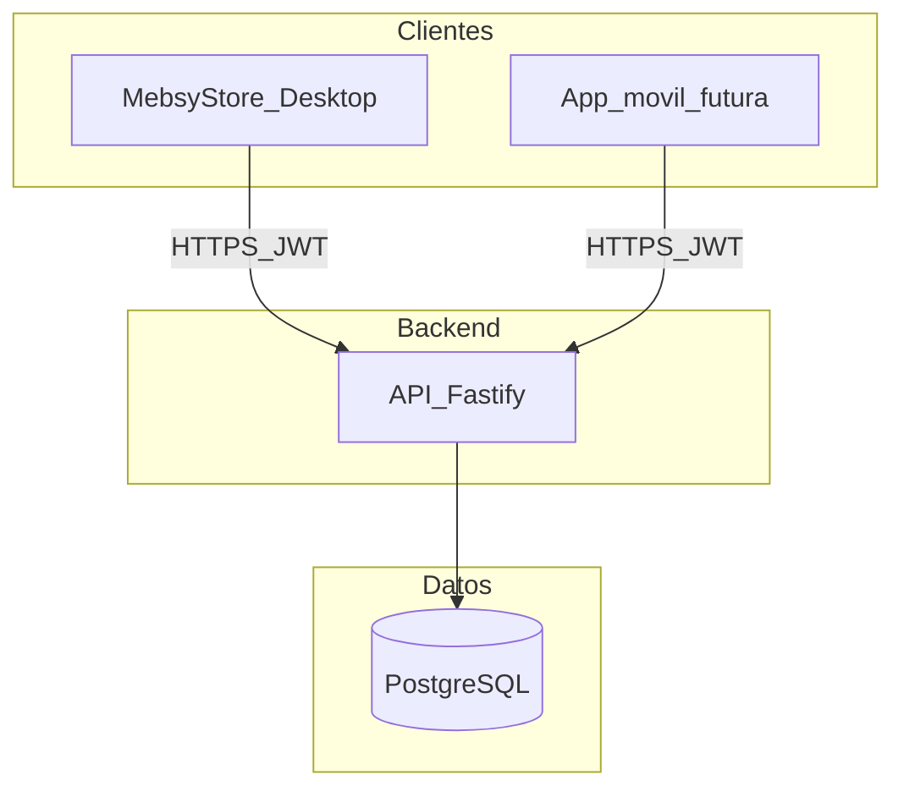

# MebsyStore — Arquitectura API multi-sucursal

## Objetivo

Stock y catálogo con **una sola fuente de verdad** (Postgres). El desktop Electron es cliente HTTP; la API Fastify aplica reglas de negocio y autorización por rol/sede.

## Decisión de diseño

| Tema | Elección |
|------|----------|
| Backend | **Node.js + Fastify** (`api/`) con casos de uso propios |
| BD central | **Supabase Postgres** (proyecto MebsyStoreDesktop) |
| Clientes | Desktop Electron; futura app móvil admin |
| Auth | JWT HS256 de acceso (`JWT_EXPIRES_IN`, p. ej. 8h). Sin refresh token aún |
| Sync | Cloud + SSE in-process (`sale.created`, `stock.updated`, …) |
| Offline | Fase futura |
| Facturación | Nubefact para 01/03; NV interna; UBL/PDF local solo como fallback |
| Tipos compartidos | `core/types.ts`, `core/money.ts`, `core/ubl/*` (sin SQLite) |

## Arquitectura



### Roles

- **PostgreSQL**: empresa, sucursales, usuarios, productos, stocks, ventas, comprobantes, movimientos, transferencias.
- **API**: auth, autorización por sucursal, ventas, inventario, Nubefact.
- **Desktop**: IPC → `ApiClient`; impresión de ticket HTML (NV) o PDF Nubefact (CPE).
- **Migraciones**: `supabase/migrations/*.sql` es la fuente de verdad DDL; Drizzle schema en `api/src/infrastructure/persistence/drizzle/schema.ts`.

## Monorepo actual

```
SistemaPos/
  api/                  # Fastify + Drizzle Postgres
  core/                 # types, money, ubl, crypto
  src/                  # Electron main/preload/renderer
  supabase/migrations/  # SQL incremental
  docs/
```

## Auth y sucursales

- Login devuelve usuario + sucursales permitidas.
- Cajero **debe** enviar `sucursalId` en listados de ventas/comprobantes; admin puede omitirlo.
- Credenciales Nubefact no se exponen al renderer (solo flags/máscaras).

## Ventas

- Idempotencia: `ventas.idempotency_key` (único si no null).
- Correlativo: incremento atómico en `series`.
- Pagos: tabla `venta_pagos`.
- Stock: movimiento `salida` + `motivo: venta`.
- CPE: POST `/sales` espera Nubefact y el desktop imprime su PDF oficial.

## Variables de entorno (API)

- `DATABASE_URL`, `JWT_SECRET`, `PORT`, `HOST`, `PERU_API_TOKEN`
- `SUPABASE_URL` / `SUPABASE_ANON_KEY`: reservadas para futuro móvil; la API actual no las usa (solo Postgres vía `DATABASE_URL`).

## Desarrollo

```bash
pnpm dev:api          # API
pnpm dev              # Electron
# o en paralelo (si el filter lo permite):
pnpm dev:all
```
